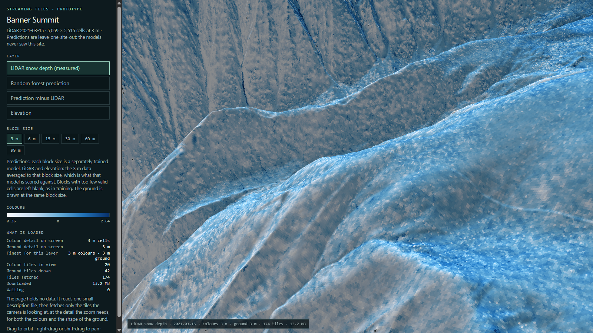

# SnowEx streaming tiles (prototype)

**[Open the live demo →](https://anantgahlaut.github.io/snowex-tiles-prototype/)**

A 3D viewer that shows full-resolution terrain, LiDAR snow depth and machine-learning
predictions in the browser without downloading the dataset. The page holds no data. It
fetches small tiles as you move, at the detail the zoom needs, for both the colours and
the shape of the ground.



*Banner Summit, Idaho: LiDAR snow depth from 2021-03-15 at 3 m cells on 3 m terrain. The
panel on the left shows how much has been fetched.*

This is a test on one site. It is the starting point for a shared viewer for the
[SnowEx Field Atlas](https://github.com/cryogars/cryogars-atlas) and the
[SnowEx model results](https://anantgahlaut.github.io/cryogars-atlas-results/).

## What you can look at

| Layer | What it is |
| --- | --- |
| LiDAR snow depth | Measured snow depth, 3 m cells |
| Random forest prediction | Snow depth predicted by a model that never saw this site |
| Prediction minus LiDAR | Blue where the model predicts too much snow, red where too little |
| Elevation | The LiDAR terrain model |

The block-size buttons (3 m to 99 m) apply to every layer:

- **Predictions and errors** switch between six separately trained models, one per block size.
- **LiDAR snow depth and elevation** switch to the 3 m data averaged to that block size. For
  snow depth these are the values the model at that block size is scored against, so you can
  put what was measured next to what was predicted at the same detail.
- **The ground** is drawn at the same block size, so each coloured cell sits on its own piece
  of terrain.

All snow-depth layers share one colour scale, and all error layers share another, so colours
mean the same thing at every block size.

## How it works

1. **Build.** `tools/build_pyramid.py` reads the site's layers and writes a
   [Zarr](https://zarr.dev/) store. For each layer it makes a pyramid: the full-detail grid,
   then the same grid averaged 2 x 2, and so on.
2. **Tiles.** Every level is cut into 256 x 256 chunks. Each chunk is one small compressed
   file. Chunks with no data are not written.
3. **One description file** lists every layer, every level and which chunks exist.
4. **The viewer** (`index.html`, plain WebGL2, no libraries) reads that file, picks a level
   from how far the camera is, works out which chunks are in view, and fetches only those.
   Until a chunk arrives, that patch shows the coarser level.

Zooming from the whole site to full 3 m detail in one place downloads about 4 MB of the
190 MB store.

## The store

```text
banner_summit.zarr/
  .zmetadata, zmetadata.json     description of everything below
  elevation/0 .. 6               level 0 = 3 m, each next level 2x coarser
  snow_depth_20210315/0 .. 6     LiDAR snow depth
  rf_<N>m/, error_<N>m/          prediction and error of the model trained at N m blocks
  lidar_<N>m/, elevation_<N>m/   LiDAR snow depth and elevation averaged to the same N m blocks
```

Values are 16-bit integers with a scale and offset (`value = stored * scale_factor +
add_offset`); `-32768` means no data. It is an ordinary Zarr version 2 store, so Zarr
libraries can open it too.

## Run it yourself

```bash
python -m http.server 8000
```

Then open `http://localhost:8000/`. To rebuild the store you need the site's archive file
and the prediction maps:

```bash
python tools/build_pyramid.py --site banner_summit --archive banner_summit.enriched.h5 \
    --date 20210315 --maps <folder of prediction GeoTIFFs> --out .
python -m unittest tools/test_build_pyramid.py
node tools/check_viewer.js http://localhost:8000/index.html
```

`check_viewer.js` drives a headless Chrome through the page, zooms and pans, and reports
what was fetched and whether any background shows through the ground.

## Limits of the prototype

- One site, one LiDAR date.
- No colour controls, no click-to-read values and no layer comparison yet.
- Each level of a layer lives in one graphics texture. That works at this site's size; much
  larger sites will need tiles to be dropped from memory as you move away.
- The predictions are baselines scored on unseen sites. They are not a validated snow-depth
  product.

## Data

Observations are from the NASA SnowEx campaigns (LiDAR and UAVSAR), aligned in the
[SnowEx Field Atlas v1.0.05](https://github.com/cryogars/cryogars-atlas/tree/v1.0.05).
Built by Anant Gahlaut at [CryoGARS](https://github.com/cryogars), Boise State University.

## Licence

Code: [MIT](LICENSE). The source datasets keep their own attribution and use requirements.
